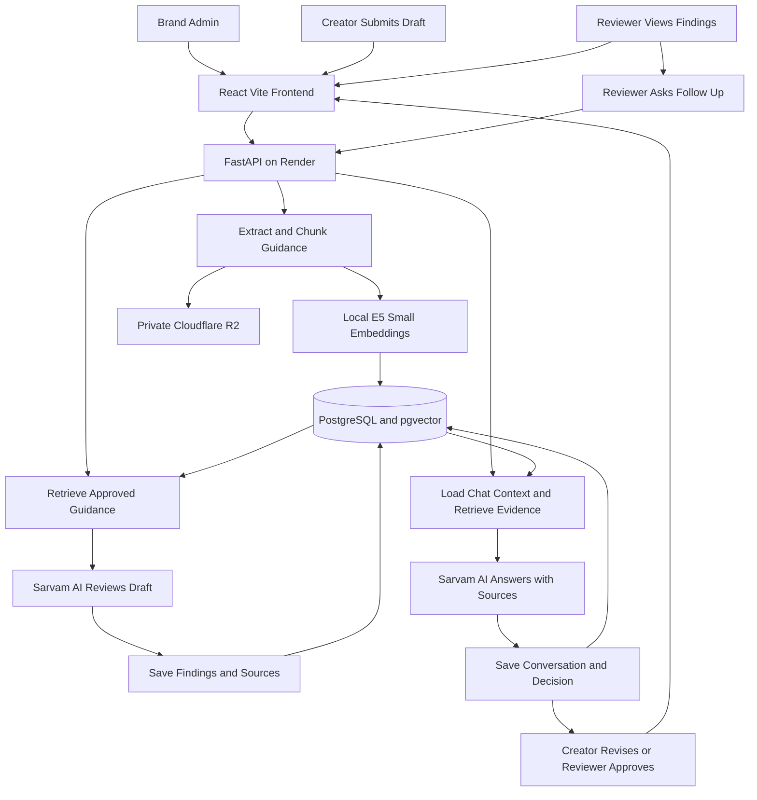
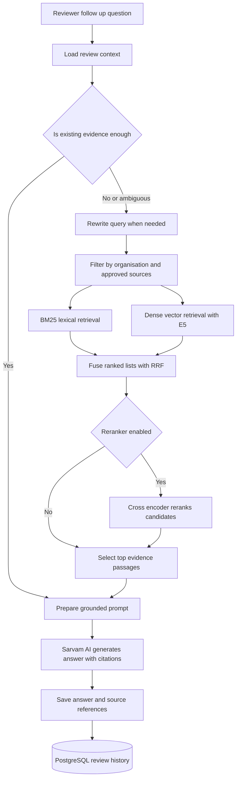

# Presentation

## Our Understanding of the Problem

Growing organisations create content through many employees, agencies, and AI tools. As more people contribute, it becomes harder to ensure that every piece of content follows the organisation’s brand guidelines and uses current, approved facts, terminology, messages, and visual assets.

This can lead to inconsistent tone or wording, outdated or incorrect information, unsupported promotional claims, off-brand visuals, and accessibility issues reaching customers. These problems can confuse people and damage the organisation’s credibility and trust.

We understand the challenge as building an intelligent brand-governance platform that reviews content before publication against an organisation’s approved guidance and sources. It should clearly explain each issue, show the relevant guideline or source, and suggest a meaningful correction that preserves the creator’s intent. Creators and authorised reviewers should stay in control of edits and approvals, with collaboration and revision history. The platform must also protect confidential materials and be transparent about AI and external services.

## User Roles and How They Use the Platform

| Role | How they use the platform |
|---|---|
| **Creator** | Submits draft content for review, reads issues and suggested edits, makes revisions manually or by applying a suggestion, and resubmits. |
| **Reviewer** *(manager, team lead, or authorised brand reviewer)* | Reviews the draft and findings, asks grounded follow-up questions, adds comments or suggested changes, then approves the content or requests revisions. |
| **Brand Administrator** | Creates the organisation profile, adds and maintains approved guidelines, facts, terminology, key messages, and assets, and manages user roles where needed. |

A manager or team lead can act as a reviewer when assigned that permission. The Creator remains responsible for revisions; the Reviewer remains responsible for the approval decision.

## Technical Stack

This is the selected project stack. Provider plans, service limits, and data terms should be checked when creating the accounts and deploying.

| Layer | Technology | Use in this project |
|---|---|---|
| Frontend | **React + Vite** | Build and serve the web interface for organisation setup, draft submission, findings, reviewer chat, comments, and approvals. |
| Styling | **Tailwind CSS** | Build responsive interface layouts and reusable UI styles. |
| Backend | **Python + FastAPI** | Provide APIs, enforce roles and organisation access, process files and text, orchestrate retrieval and model calls, and manage review states. |
| Database and vector search | **PostgreSQL + pgvector** | Store application records, approved-source chunks, embeddings, review history, and vector search data. |
| Cloud file storage | **Cloudflare R2** | Store original uploaded documents and image assets in a private bucket. Store object keys and file metadata in PostgreSQL. |
| LLM provider | **Sarvam AI** | Generate review findings, suggested edits, and grounded answers to reviewer follow-up questions. Keep the API key on the backend. |
| Embedding model | **Hugging Face `intfloat/multilingual-e5-small` (run locally)** | Independent of Sarvam: create multilingual semantic embeddings inside the FastAPI service for approved guidance and retrieval queries. This balances multilingual coverage and deployment size for a solo MVP; it is not a claim that it is universally the most accurate model. |
| Source control | **Git + GitHub** | Track development and provide the repository for review and submission. |
| Deployment | **Vercel + Render** | Deploy the React frontend on Vercel and the FastAPI backend on Render. PostgreSQL and R2 are connected services. |

Sarvam’s current public API model list documents chat and other model APIs, but I could not find a hosted text-embeddings endpoint in its public model/API documentation. Therefore this design uses the open Hugging Face model `intfloat/multilingual-e5-small` locally for embeddings and Sarvam only for LLM generation. The embedding model does not require a Sarvam embedding API. The `multilingual-e5-small` model card describes 100-language support, 384-dimensional embeddings, and a 512-token input limit; it requires `query:` and `passage:` prefixes for retrieval. We will keep guidance chunks within that limit and evaluate retrieval quality on our own examples. ([Sarvam API models](https://docs.sarvam.ai/api/getting-started/models), [E5 model card](https://huggingface.co/intfloat/multilingual-e5-small))

## Architecture and End-to-End Workflow

### Architecture Diagram



If the Markdown preview does not render Mermaid, use this same flow as a text fallback:

```text
Brand Admin -> React/Vite -> FastAPI -> extract and chunk guidance
                                      -> local multilingual-e5-small embeddings
                                      -> PostgreSQL + pgvector
                                      -> original files in private Cloudflare R2

Creator -> Vercel frontend -> FastAPI saves draft and starts review
                            -> retrieves approved passages from pgvector
                            -> sends draft plus evidence to Sarvam AI
                            -> saves findings, citations, and suggestions

Reviewer -> sees saved findings and asks follow-up questions
         -> FastAPI uses review context and retrieves evidence as needed
         -> Sarvam AI answers with evidence
         -> reviewer requests changes or approves
         -> Creator revises and resubmits; history remains in PostgreSQL
```

### Workflow by Role

1. **Brand Administrator creates the organisation:** Adds approved guidance, facts, terminology, messages, and assets through the React application.
2. **FastAPI ingests guidance:** Extracts text from supported files, splits it into short passages, generates embeddings with `intfloat/multilingual-e5-small`, and saves passage text, embedding, source, version, and `organisation_id` in PostgreSQL. Original files go to a private R2 bucket; their object keys and metadata are saved in PostgreSQL.
3. **Creator submits a draft:** FastAPI verifies the user’s role and organisation, stores the draft and revision in PostgreSQL, and marks it as `processing`.
4. **Initial RAG review runs:** FastAPI embeds the retrieval query locally, searches only approved guidance for that organisation, and sends the draft plus relevant source passages to Sarvam AI. The model is instructed to return structured issues, explanations, source references, and suggested edits, and to state when evidence is insufficient.
5. **Reviewer sees the result:** FastAPI validates and saves the findings and sets the state to `ready_for_review`. React displays the draft, findings, citations, and suggestions.
6. **Reviewer asks follow-up questions:** FastAPI loads the relevant draft revision, selected finding, cited sources, and a short window of recent conversation. Direct questions can reuse existing evidence; new questions retrieve more approved sources. Ambiguous questions are rewritten into standalone retrieval queries using the review context. Sarvam AI receives the question and grounded context and returns an answer with source references. The question, answer, and references are saved in PostgreSQL.
7. **Reviewer requests revisions or approves:** Comments and the decision are recorded against the draft revision. The Creator sees the feedback in the platform, revises manually or applies a suggestion, and resubmits. The updated revision is reviewed again. The Reviewer makes the final approval decision.

## RAG, Database, and Storage Design

### Detailed RAG Architecture



The diagram shows the adaptive retrieval path. When an existing finding already contains the evidence needed for a direct question, the system can reuse that evidence. If the question is ambiguous or asks about new facts or rules, it performs a fresh hybrid search. Candidate reranking is optional after measurement; RRF results remain available when it is disabled.

### RAG Approach

The platform uses **adaptive conversational RAG** for reviewer follow-up questions and evidence-grounded checks for submitted drafts. The flow combines conversation context, tenant-scoped retrieval, hybrid search, result fusion, reranking, and grounded generation.

1. **Index approved sources:** FastAPI extracts text from supported administrator-uploaded guidance, splits it into passages, and adds metadata such as `organisation_id`, document, section, category, approval state, and version. The local `intfloat/multilingual-e5-small` model creates passage embeddings using the `passage:` prefix. FastAPI stores passages, metadata, and vectors in PostgreSQL with pgvector. Original files go to private Cloudflare R2.
2. **Save and review a draft:** When the Creator submits content, FastAPI saves the draft and revision in PostgreSQL. For the first review, it retrieves guidance relevant to the draft and sends the draft with a bounded set of source passages to Sarvam AI. Sarvam returns structured findings, explanations, source IDs, and suggested edits. FastAPI validates and saves them; the Reviewer sees them in React.
3. **Load follow-up context:** For each Reviewer question, FastAPI loads the active organisation, review, draft revision, relevant finding, its citations, and a small recent chat window. Chat history is stored in PostgreSQL; the LLM is not treated as the system’s permanent memory.
4. **Choose the retrieval path adaptively:** Reuse a finding’s cited evidence for a direct question when it is sufficient. If the question contains references such as “this claim” or “why was that flagged,” rewrite it into a self-contained search query using the active finding and recent turns. Run fresh retrieval for new claims, new rules, or insufficient existing evidence. Keep both the raw question and rewritten query for traceability.
5. **Run hybrid retrieval when needed:** Search approved passages using two methods in parallel:
   - **BM25 lexical search** finds exact brand terms, product names, and phrases.
   - **Dense vector search** embeds the rewritten or original query with the `query:` prefix and searches pgvector for semantically related passages.
6. **Fuse and optionally rerank:** Merge the two ranked result lists with **Reciprocal Rank Fusion (RRF)**. If evaluation shows enough benefit within Render's memory and latency limits, score the best candidates with a multilingual cross-encoder reranker. Send only a small, relevant set of passages to Sarvam AI.
7. **Generate and save a grounded answer:** Sarvam receives the question, relevant conversation context, and selected source passages. It must cite the sources used and say when the approved material does not support an answer. Save the question, answer, citation metadata, and associated draft revision in PostgreSQL.
8. **Continue the human workflow:** The Reviewer adds a comment, asks another question, requests revisions, or approves. The Creator revises and resubmits; the review and chat history remain attached to their specific revisions.

### Concrete Retrieval Components and Deployment Fit

| Stage | MVP implementation | Notes |
|---|---|---|
| Dense retrieval | `intfloat/multilingual-e5-small` locally in FastAPI plus pgvector | Multilingual embedding model; use `passage:` for indexed source text and `query:` for reviewer queries. Keep chunks within the model’s 512-token input limit. |
| BM25 lexical retrieval | Python `rank-bm25` over the current organisation’s approved passages loaded from PostgreSQL | A simple, feasible BM25 implementation for a small hackathon corpus. Filter by organisation and approved status before ranking; refresh the in-memory corpus when source versions change. |
| Result fusion | Reciprocal Rank Fusion in FastAPI | Combines ranks from BM25 and dense search without assuming their raw scores are directly comparable. |
| Reranking (optional after measurement) | `BAAI/bge-reranker-v2-m3` locally in the worker on the fused top candidates | Multilingual cross-encoder that scores a question together with each passage. Enable only if measured quality improves enough for its latency and memory cost; otherwise use RRF ranking. ([Model card](https://huggingface.co/BAAI/bge-reranker-v2-m3)) |
| Answer generation | Sarvam AI LLM API | Receives only the question, necessary chat context, and selected evidence passages; outputs a grounded answer with source references. |

**Render/PostgreSQL constraint:** Render’s managed PostgreSQL supports pgvector, but its documentation says ParadeDB’s `pg_search` BM25 extension cannot currently be installed directly into Render Postgres. Running ParadeDB as a separate private PostgreSQL service is possible but requires paid resources. For the solo MVP, Python `rank-bm25` avoids adding that second database service. If the corpus grows, revisit a dedicated BM25-capable search service or database. ([Render supported extensions](https://render.com/docs/postgresql-extensions), [Render ParadeDB deployment guide](https://render.com/docs/deploy-paradedb))

### When Adaptive Conversational RAG Is Used

- **Reuse evidence:** A direct follow-up asks about a finding already displayed, and its cited approved passage clearly answers it. Pass that evidence and a small relevant chat window to Sarvam without a new search.
- **Rewrite and retrieve:** The question is context-dependent or ambiguous, such as “Why was that flagged?” Resolve “that” using the active finding and draft revision, rewrite as a standalone question, then run hybrid retrieval.
- **Retrieve fresh evidence:** The Reviewer asks about a different claim, a different guideline, an updated fact, or challenges whether the existing source is current. Search the current approved knowledge base again.
- **Ask for clarification or abstain:** The question cannot be resolved to a finding, or retrieval returns no sufficiently relevant approved evidence. Ask the Reviewer to clarify or state that the source material is insufficient; do not invent a rule.

Adaptive retrieval is a controlled routing decision inside FastAPI, not an autonomous agent. The backend chooses whether to reuse evidence, rewrite and retrieve, or ask for clarification. The model does not approve content or publish changes.

### Privacy, Access, and Reliability Rules

- Every database lookup and search must filter by the current `organisation_id`, user permissions, approved status, and applicable source version.
- Do not mix draft content into the approved guidance index. Draft text is review input; approved source passages are the grounding corpus.
- Keep API keys on the backend. Send Sarvam only the minimum draft and retrieved context needed for the requested review or answer.
- Draft text and evidence sent to Sarvam are processed by an external service. Disclose this and check current provider data terms before using real confidential material.
- Preserve source IDs and versions with findings and chat answers so a Reviewer can inspect where a claim came from.
- Measure retrieval quality with sample reviewer questions: whether the right source appears in the top results, whether the final answer cites it, and whether unsupported questions are declined. Enable reranking only if it improves results enough to justify added latency and hosting load.

### Data Placement

| Data | Location |
|---|---|
| Organisation profiles, user roles, drafts, revisions, statuses, findings, comments, decisions, and chat turns | PostgreSQL |
| Approved-source passages, source metadata, embeddings, and vector index | PostgreSQL with pgvector |
| Original supported `.txt` and `.md` uploads in the MVP; PDFs and images only if added later | Private Cloudflare R2 bucket |
| LLM prompts and responses | Sent through FastAPI to Sarvam AI as required for review and follow-up; store only the records needed for review history in PostgreSQL |
| Secrets and API keys | Render/Vercel environment settings as appropriate; never expose the Sarvam key in frontend code or GitHub |

All database queries and retrieval must be scoped by organisation and role to prevent cross-organisation access. R2 objects should not be publicly accessible by default. Draft text and retrieved source passages sent to Sarvam AI leave the application’s database boundary and are processed by that external provider; review its current data-handling terms and disclose this clearly. Vercel, Render, PostgreSQL hosting, and R2 also process or store project data according to their configurations and terms. Do not promise that confidential information never reaches an external service.

## Solo MVP Scope

Prioritise one reliable workflow: one organisation profile, text-based guidance, text draft submission, evidence-backed findings, reviewer follow-up chat, revision requests, and approval history. The MVP retrieval path is BM25 plus dense vector search, fused with RRF. Adaptive follow-ups reuse already-sufficient evidence and skip extra retrieval. Add local cross-encoder reranking for fresh searches only if measured quality improves enough within Render's latency and memory limits; otherwise report the RRF-only result. Add PDF/image extraction, notifications, and analytics only after the core workflow works within the hackathon build window.

## Development Plan for the Next Two Rounds

I am the sole participant and will build the frontend, backend, retrieval pipeline, evaluation, deployment, and documentation. The sequence below is relative to the **official build window**, because the problem statement does not give its start or the submission deadlines. Research, this plan, and the synthetic data pack are preparation; implementation work must be done in the official window to count toward judging. Keep Git commits and a short progress log as evidence of when each feature was built. If Round 1 has already been submitted, use the same three improvement names that were actually submitted, or clearly explain any change to the judges.

### Three Improvements to Track Across Both Rounds

| Named improvement | Round 2 demonstrable state | Round 3 delivered state and proof |
|---|---|---|
| **1. Grounded hybrid review** | Retrieve approved, organisation-scoped guidance using BM25 and pgvector, fuse results with RRF, and show a source ID/version beside each finding. Show an explicit “needs human review” result when evidence is missing. | Evaluate retrieval and findings on the development and untouched holdout draft cases; fix missed rules and unsupported flags. Add reranking only if measured quality improves enough for the Render latency and memory cost. Show actual results and one failure case. |
| **2. Context-aware reviewer follow-ups** | Reviewer asks a question about a finding; the app saves the question and answer against the active draft revision and cites the evidence used. | Route direct questions to existing evidence, rewrite ambiguous questions, run fresh hybrid retrieval for new topics, and ask for clarification or abstain when sources are insufficient. Evaluate route choice, cited source IDs, and answer support on follow-up cases. |
| **3. Revision-aware human approval** | Creator submits, Reviewer requests changes, Creator resubmits, and Reviewer approves; each decision and comment has an actor, time, and revision. | Complete role and organisation access checks, show a readable revision timeline, prevent stale-revision approval, and summarise recurring finding categories from saved reviews. Verify the complete cycle with separate Creator and Reviewer accounts. |

The data pack is a **fictional demo and evaluation fixture**, not evidence of real customers or measured model performance. Only `data/knowledge/records.jsonl` is normal approved-knowledge input. Use `data/evaluation/` as offline test cases, never as retrieval knowledge or model prompt answers; keep its holdout cases untouched until the final evaluation. For the text-only MVP, score only the 12 text drafts (7 development, 5 holdout) and 9 follow-up cases linked to those drafts (6 development, 3 holdout). Treat image-metadata cases as future-format or unsupported-format checks, not as evidence that images were analysed. Public references remain research material unless a Brand Administrator explicitly adopts them.

### Round 2 — The Build

| Order | Build work | Exit evidence |
|---|---|---|
| 1. Foundation | Initialise the Git repository during the official build window; create the React/Vite/Tailwind app and FastAPI service; provision Render PostgreSQL with pgvector and private R2; add migrations, organisation-scoped users/roles, environment configuration, and a reproducible demo seed. | Creator, Reviewer, and Brand Administrator can sign in; an unauthorised role or other organisation cannot read or act on a draft. Secrets are absent from the client and repository. |
| 2. Approved knowledge | Let the Brand Administrator register approved guidance; store source/version/status and original file; chunk and embed only approved, current, organisation-matched records. | The demo can load the fictional brand pack, display indexed source versions, and exclude archived or other-organisation fixture records. |
| 3. Creator-to-Reviewer flow | Save a text draft and revision, run a grounded Sarvam review, validate structured findings, and show issue, explanation, citation, and suggested edit. Add reviewer comments, a follow-up question, revision request, resubmission, and approval. | Live demo completes one full loop with two accounts and persisted history after reload; unsupported claims are marked for human review instead of receiving invented evidence. |
| 4. Deploy and submit | Deploy frontend to Vercel and API/database to Render; connect private R2; write setup, architecture, API/model/data/provider disclosure, privacy note, and known limitations. Run a small development-case evaluation and request structured feedback if a real participant is available. | Judge-accessible repository and deployed link or clear functional demo; smoke-test the deployed loop; record actual outputs, observed errors, feedback if obtained, and sole-contributor statement. |

Round 2 priority follows its rubric: a complete working flow (30 points), technical depth and reliability (25), visible progress (20), the three named improvements (15), and usability (10). Stop adding features if the core loop is unstable. Show source versions and review states in the interface so judges can inspect what the AI used and what the humans decided.

### Round 3 — The Finish

| Order | Finish work | Exit evidence |
|---|---|---|
| 1. Deliver the three improvements | Complete the three rows above: compare hybrid retrieval with the baseline, finish adaptive follow-up routing, harden revision and approval checks, and add a compact recurring-issues view from stored finding categories. | Each improvement has a short before/after demo, actual evaluation output, and a linked commit or change-log entry. Do not claim an improvement if its evidence is absent. |
| 2. Reliability and real-world fit | Test normal and failure paths: empty/unsupported source, changed source version, Sarvam timeout or malformed response, duplicate submission, wrong role or organisation, and stale approval. Make errors understandable and allow retry where safe. Check keyboard navigation, labels, contrast, and responsive layout. | End-to-end deployed smoke test passes; record latency and the pass/fail counts for the development and holdout cases. Document false positives, missed issues, and any unsupported content format. |
| 3. Broaden only after stability | If time remains, support one additional useful input such as text-extracted PDF or a structured social post with image/alt-text fields. A visual check requires actual image processing and an approved asset reference; metadata-only fixtures do not prove it. | Demonstrate the added format end to end, or state it as a limitation and roadmap item. Do not weaken the text workflow to claim broad format support. |
| 4. Final submission | Update the README and presentation with the final architecture, models/APIs/datasets, privacy and external-service disclosure, accessibility, security, user feedback if actually collected, limitations, roadmap, and sole-contributor details. Record the demo video or prepare the requested live demo. | Final product and repository, demo, concise report, evaluation evidence, and complete participant details match the organiser’s required format. |

Round 3 priority follows its rubric: product completeness (25 points), delivery of the three improvements (20), reliability (20), usability and real-world fit (20), and documentation/roadmap (15). Reserve the final part of the build window for deployed verification and presentation rather than starting another major feature.

## Sources for Technical Choices

- [Sarvam API model catalogue](https://docs.sarvam.ai/api/getting-started/models)
- [Sarvam pricing and credits](https://docs.sarvam.ai/api/getting-started/pricing)
- [intfloat/multilingual-e5-small model card](https://huggingface.co/intfloat/multilingual-e5-small)
- [pgvector project documentation](https://github.com/pgvector/pgvector)
- [BAAI multilingual reranker model card](https://huggingface.co/BAAI/bge-reranker-v2-m3)
- [Render supported PostgreSQL extensions](https://render.com/docs/postgresql-extensions)
- [Render ParadeDB deployment guide](https://render.com/docs/deploy-paradedb)
- [Cloudflare R2 documentation](https://developers.cloudflare.com/r2/)
- [Vercel documentation](https://vercel.com/docs)
- [Render documentation](https://render.com/docs)


