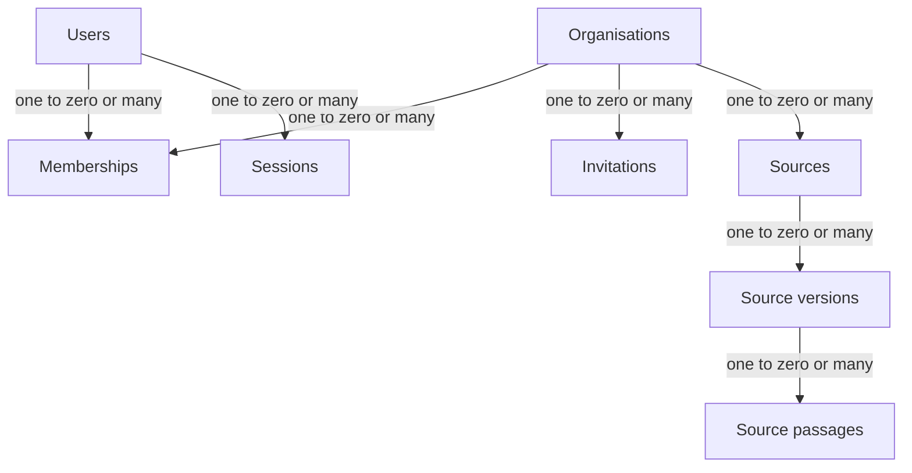
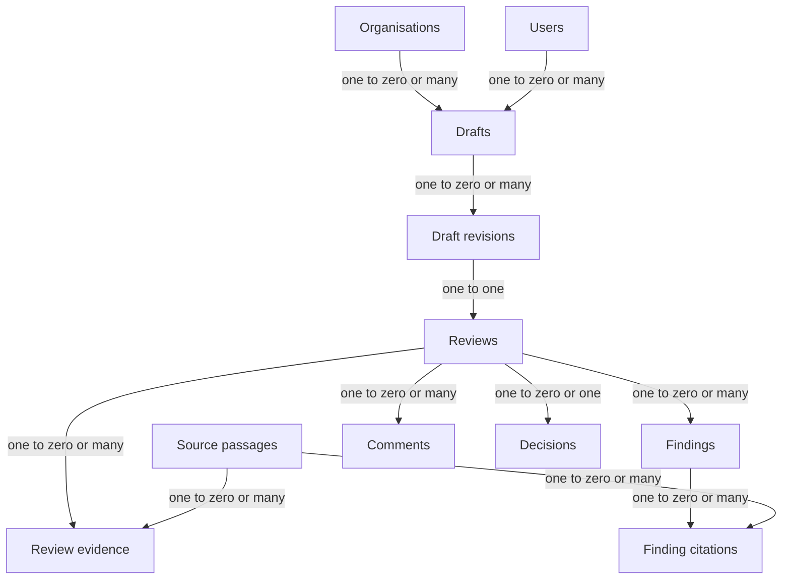
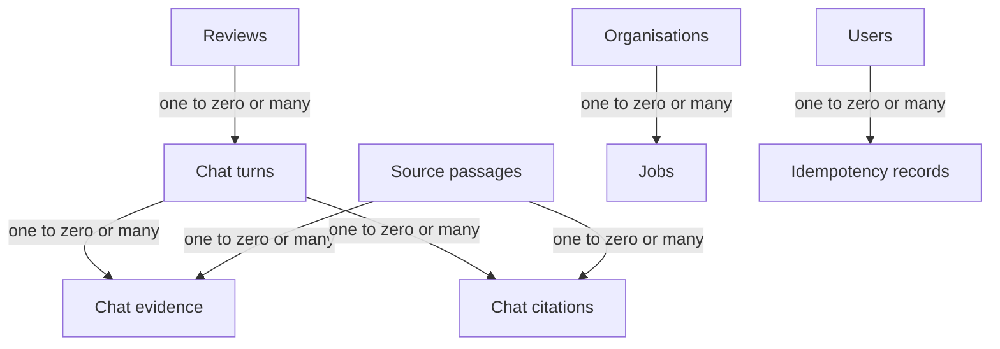

# VeriLoom database design and ERD

This is the implementable PostgreSQL record design for the Round 2 text-only MVP. It translates the resource names, state machines, and concurrency rules in [API Contracts.md](API%20Contracts.md) into tables. PostgreSQL and `pgvector` run on Render; original source files live in private Cloudflare R2. The database holds approved source passages, draft text, review records, and durable jobs. It does **not** treat drafts, evaluation labels, or public research as the approved knowledge base.

## 1. Design rules

1. Every organisation-owned row has `org_id uuid NOT NULL`. An authenticated user's `org_id` comes from the checked membership and route, never from a trusted browser body field.
2. A `source` identifies a logical document. A `source_version` identifies one immutable upload. Only an ingested, approved, currently effective version participates in new retrieval.
3. Each `draft_revision` is an immutable submitted snapshot. `drafts` contains only the editable working copy and current state. Findings, questions, comments, and decisions attach to the submitted review, not to a moving draft body.
4. Approval changes are human actions. A generated finding or answer cannot update a draft, approve a source, or approve a review.
5. Database transactions end before R2, embedding, reranking, or Sarvam calls. Jobs are the durable boundary for those operations.
6. `created_at` and `updated_at` are `timestamptz` in UTC. Effective policy dates are `date`, interpreted in `organisations.time_zone`.

## 2. Entity relationship diagrams

These smaller diagrams use Mermaid `flowchart` syntax, which is also used in [PRESENTATION.md](../PRESENTATION.md), to work in previews that do not render Mermaid's `erDiagram` type. Arrow labels show the logical cardinality from the left table to the right table; the tables below define the exact foreign keys. Repeated boxes refer to the **same** table. `org_id` also appears on tenant-owned child tables for scoping and composite foreign keys.

**Identity and approved knowledge**

**Drafts, reviews, and findings**

**Follow-up questions and durable work**

`INVITATIONS.invited_by_user_id`, `REVIEWS.reviewer_user_id`, `CHAT_TURNS.actor_user_id`, `COMMENTS.actor_user_id`, and `DECISIONS.actor_user_id` also reference `USERS`. Those extra arrows are omitted to keep the drawings legible. A revision receives exactly one review in the atomic submission transaction; the database's `UNIQUE (revision_id)` constraint alone enforces **at most** one.

## 3. Tables and constraints

Unless stated otherwise, every primary key is `uuid DEFAULT gen_random_uuid()`, and every tenant-owned table also has `UNIQUE (org_id, id)` so child tables can use a composite `(org_id, parent_id)` foreign key. Use `ON DELETE RESTRICT` for audited content and citations. This is a schema blueprint, not a claim that migrations already exist.

### 3.1 Identity and tenancy

| Table | Columns and types | Constraints and purpose |
|---|---|---|
| `users` | `id uuid PK`, `email text`, `display_name text`, `password_hash text`, `created_at timestamptz`, `disabled_at timestamptz NULL` | Store lowercase-normalised email; unique `email`. Passwords use a current password hash in application code; no plaintext or reset token in this table. |
| `organisations` | `id uuid PK`, `slug text`, `name text`, `time_zone text`, `corpus_version bigint DEFAULT 0`, `created_at timestamptz`, `updated_at timestamptz` | Unique `slug`; `corpus_version >= 0`. Validate `time_zone` against IANA names in application code. `corpus_version` increments on activation or archive of approved knowledge. |
| `memberships` | `id uuid PK`, `org_id uuid FK`, `user_id uuid FK`, `roles text[]`, `status text`, `created_at timestamptz` | Unique `(org_id,user_id)`; nonempty roles drawn only from `admin`, `creator`, `reviewer`; status `active` or `disabled`. Multiple roles are allowed, but a Creator cannot approve their own revision. |
| `invitations` | `id uuid PK`, `org_id uuid FK`, `email text`, `roles text[]`, `token_hash bytea`, `invited_by_user_id uuid FK`, `expires_at timestamptz`, `accepted_at timestamptz NULL`, `created_at timestamptz` | Unique `token_hash`; same roles check as memberships; accept once under row lock. Store only a hash of the single-use token. |
| `sessions` | `id uuid PK`, `user_id uuid FK`, `token_hash bytea`, `expires_at timestamptz`, `revoked_at timestamptz NULL`, `created_at timestamptz`, `last_seen_at timestamptz NULL` | Unique `token_hash`; cookie carries an opaque random token. A session identifies a user; each request still checks membership for its route `org_id`. |

### 3.2 Approved source corpus

| Table | Columns and types | Constraints and purpose |
|---|---|---|
| `sources` | `id uuid PK`, `org_id uuid FK`, `title text`, `category text`, `created_by_user_id uuid FK NULL`, `created_at timestamptz`, `archived_at timestamptz NULL` | Logical document. `archived_at` hides the source from future use; it does not delete historical passages. Uploaded `category` is `guidelines\|facts\|terminology\|messaging` per API; seeded passages can carry more specific atomic categories. A seed-created source may lack a human `created_by_user_id`. |
| `source_versions` | `id uuid PK`, `org_id uuid`, `source_id uuid`, `version_label text`, `title text`, `category text`, `r2_object_key text NULL`, `origin_path text NULL`, `sha256 char(64)`, `mime_type text NULL`, `byte_size bigint NULL`, `effective_from date`, `effective_to date NULL`, `ingestion_status text`, `approval_status text`, `ingestion_error_code text NULL`, `uploaded_by_user_id uuid NULL`, `created_at timestamptz`, `ready_at timestamptz NULL`, `approved_at timestamptz NULL`, `archived_at timestamptz NULL` | Composite FK `(org_id,source_id)`; unique `(org_id,source_id,id)` for passage FKs; unique `(source_id,version_label)` and unique non-null `r2_object_key`; `byte_size IS NULL OR byte_size > 0`; `effective_to IS NULL OR effective_to > effective_from`; ingestion `queued\|processing\|ready\|failed`; approval `pending\|approved\|archived`. The uploaded title/category are snapshotted on each version, and ingestion reads that snapshot. The logical source displays the currently approved version's metadata until a replacement is approved. Partial unique index `(source_id) WHERE approval_status='approved'`. A seeded version uses `origin_path` from the data pack and can lack an R2 original; the original-download endpoint reports unavailable for it. User uploads require non-null R2 key, MIME, byte size, and uploader. |
| `source_passages` | `id uuid PK`, `org_id uuid`, `source_id uuid`, `version_id uuid`, `source_ref text`, `chunk_index integer`, `title text`, `text_content text`, `start_offset integer`, `end_offset integer`, `category text`, `embedding vector(384)`, `embedding_model text`, `created_at timestamptz` | Composite FK `(org_id,source_id,version_id)` to `source_versions(org_id,source_id,id)` and `(org_id,source_id)` to `sources`; unique `(version_id,source_ref,chunk_index)`; `chunk_index >= 0`, `0 <= start_offset < end_offset`, nonempty text. `title` preserves an atomic fixture record title or a generated uploaded-document passage title. `source_ref` preserves canonical fixture IDs, or generated `DOC-{source_id}#P0001` style IDs. Passage text and vector are immutable once version is `ready`; no draft chunks here. |

The source search predicate is `org_id = :org_id`, `approval_status = 'approved'`, `ingestion_status = 'ready'`, `effective_from <= :as_of_date`, and `(effective_to IS NULL OR :as_of_date < effective_to)`. Join `source_passages` to `source_versions` and `sources`; also exclude a source with `sources.archived_at IS NOT NULL`. The date is calculated in the organisation's time zone. Keep version and passage IDs in every evidence snapshot so a later approval cannot silently change a running review. The API's read-time `current_status` is derived from the current version and date: `archived` for an archived/replaced source or version, `expired` for an otherwise approved version past `effective_to`, and `approved` for a currently eligible version. It is not frozen in `finding_citations` or `chat_citations`. Pending versions have no public evidence status.

The upload API does not accept `version_label`. Assign the initial label in the new source's creation transaction; for later versions, allocate the next label while holding the existing source row lock. Return the assigned label in version metadata. Seeded versions keep the fixture's `source_version` value. Passage vectors may be stored while a version is pending, but retrieval must filter that version out until an Admin approves it.

### 3.3 Draft, review, and human decision

| Table | Columns and types | Constraints and purpose |
|---|---|---|
| `drafts` | `id uuid PK`, `org_id uuid`, `creator_user_id uuid`, `title text`, `channel text`, `content_format text DEFAULT 'text'`, `working_content text`, `working_copy_version bigint DEFAULT 1`, `state text`, `current_revision_id uuid NULL`, `created_at timestamptz`, `updated_at timestamptz` | `working_copy_version >= 1`; `content_format='text'` in MVP; state `editing\|processing\|ready_for_review\|review_failed\|changes_requested\|approved`. `current_revision_id` is set in the submission transaction; enforce it belongs to this draft with a composite FK or deferred constraint trigger. |
| `draft_revisions` | `id uuid PK`, `org_id uuid`, `draft_id uuid`, `revision_number integer`, `title text`, `channel text`, `content_format text`, `content_nfc text`, `content_sha256 char(64)`, `submitted_by_user_id uuid`, `submitted_at timestamptz` | Composite FK `(org_id,draft_id)`; unique `(draft_id,revision_number)`, `revision_number >= 1`. Snapshot title/channel/content after NFC normalisation. Reject UPDATE/DELETE outside an explicit audited retention process. |
| `reviews` | `id uuid PK`, `org_id uuid`, `revision_id uuid`, `reviewer_user_id uuid`, `state text`, `review_version bigint DEFAULT 1`, `reviewed_against_corpus_version bigint NULL`, `evidence_as_of_date date NULL`, `coverage text NULL`, `coverage_reason text NULL`, `prompt_version text NULL`, `model_id text NULL`, `validator_outcome text NULL`, `error_code text NULL`, `created_at timestamptz`, `completed_at timestamptz NULL`, `updated_at timestamptz` | Unique `revision_id`; composite FK `(org_id,revision_id)`; state `queued\|processing\|ready_for_review\|failed\|changes_requested\|approved`; `review_version >= 1`; coverage `sufficient\|partial\|insufficient`. Worker records corpus version/date and the validator result. Failed reviews have no approval path. |
| `review_evidence` | `id uuid PK`, `org_id uuid`, `review_id uuid`, `passage_id uuid`, `rank integer`, `supplied_text text`, `source_version text`, `retrieval_scores jsonb NULL` | Composite FKs to review and passage; unique `(review_id,passage_id)`, `rank >= 1`. Store the exact passage text supplied to the review prompt, including passages that were not cited in a finding. It makes model citation allowlisting and historical retrieval inspection possible. Scores are diagnostic, not authority. |
| `findings` | `id uuid PK`, `org_id uuid`, `review_id uuid`, `category text`, `severity text`, `evidence_status text`, `quote text NULL`, `anchor_start integer NULL`, `anchor_end integer NULL`, `explanation text`, `suggested_edit text NULL`, `sort_order integer`, `created_at timestamptz` | Composite FK `(org_id,review_id)`; category `tone\|terminology\|factual_claim\|promotional_claim\|accessibility\|visual_asset\|other`; severity `low\|medium\|high`; evidence status `supported\|insufficient`. Either both anchor offsets are NULL or `0 <= anchor_start < anchor_end`. Server verifies `quote` equals the Unicode code-point slice of immutable `content_nfc`; end is exclusive. `insufficient` findings have no citations. |
| `finding_citations` | `id uuid PK`, `org_id uuid`, `finding_id uuid`, `passage_id uuid`, `source_ref text`, `source_version text`, `source_title text`, `excerpt text`, `effective_from date`, `sort_order integer` | Composite FKs to finding and passage. Snapshot display fields from `source_passages.title` and its version, while `passage_id` remains the provenance key. Unique `(finding_id,passage_id)`. Cited passage must appear in this review's `review_evidence`. Historical citation remains readable after source archival. |
| `chat_turns` | `id uuid PK`, `org_id uuid`, `review_id uuid`, `actor_user_id uuid`, `finding_id uuid NULL`, `question text`, `rewritten_query text NULL`, `route text NULL`, `answer text NULL`, `state text`, `answer_status text NULL`, `reviewed_against_corpus_version bigint NULL`, `evidence_as_of_date date NULL`, `router_version text NULL`, `rewrite_prompt_version text NULL`, `answer_prompt_version text NULL`, `model_id text NULL`, `validator_outcome text NULL`, `error_code text NULL`, `created_at timestamptz`, `answered_at timestamptz NULL` | Composite FK `(org_id,review_id)`; optional finding must belong to this review. State `queued\|processing\|completed\|failed`; completed answer status `answered\|clarification_needed\|insufficient_evidence`. Route `reuse_evidence\|rewrite_retrieve\|fresh_retrieve\|clarify\|abstain`. Store raw question and rewritten query separately. A failed turn must not look like a grounded answer. |
| `chat_evidence` | `id uuid PK`, `org_id uuid`, `turn_id uuid`, `passage_id uuid`, `rank integer`, `supplied_text text`, `source_version text`, `retrieval_scores jsonb NULL` | Composite FKs to turn and passage; unique `(turn_id,passage_id)`, `rank >= 1`. Store the exact passages supplied to the answer prompt, even if its answer cites only a subset. On reuse, recheck current approval/effective state before inserting. |
| `chat_citations` | `id uuid PK`, `org_id uuid`, `turn_id uuid`, `passage_id uuid`, `source_ref text`, `source_version text`, `source_title text`, `excerpt text`, `effective_from date`, `sort_order integer` | Same provenance and immutable display snapshot as `finding_citations`; unique `(turn_id,passage_id)`. Cited passage must appear in this turn's `chat_evidence`. |
| `comments` | `id uuid PK`, `org_id uuid`, `review_id uuid`, `revision_id uuid`, `actor_user_id uuid`, `body text`, `created_at timestamptz` | Append-only human discussion on a particular review and its immutable revision. Validate that `revision_id` equals `reviews.revision_id`, preferably through a composite unique key on `(org_id,id,revision_id)` in `reviews` and a composite FK. A reviewer request for changes also creates a decision with its required comment; do not infer a decision from a free comment. |
| `decisions` | `id uuid PK`, `org_id uuid`, `review_id uuid`, `actor_user_id uuid`, `action text`, `comment text NULL`, `override_reason text NULL`, `expected_review_version bigint`, `created_at timestamptz` | Unique `review_id`, because a submitted revision can receive one terminal decision; action `request_changes\|approve`. `request_changes` needs nonblank comment. Approval with high findings or insufficient coverage needs an `override_reason` of at least 15 characters, checked in the transaction. Creator and approver cannot be the same user. Append-only. |

The API calls the resource `review_state="failed"` and draft state `review_failed`; these are deliberately different strings. The database maps each state to its own table exactly.

### 3.4 Durable work and replay safety

| Table | Columns and types | Constraints and purpose |
|---|---|---|
| `jobs` | `id uuid PK` exposed internally as `job_id`, `org_id uuid`, `kind text`, `resource_id uuid`, `state text`, `attempts integer DEFAULT 0`, `run_after timestamptz`, `lease_until timestamptz NULL`, `worker_id text NULL`, `last_error_code text NULL`, `created_at timestamptz`, `updated_at timestamptz` | Kind `ingest_source\|review_revision\|answer_question`; state `queued\|running\|succeeded\|failed`; `attempts >= 0`. `resource_id` points to `source_versions`, `reviews`, or `chat_turns` according to kind, so a polymorphic SQL FK is unavailable; handler checks same-org target existence. Partial unique active-job index on `(kind,resource_id) WHERE state IN ('queued','running')`. |
| `idempotency_records` | `id uuid PK`, `user_id uuid`, `org_id uuid`, `endpoint text`, `key uuid`, `request_sha256 char(64)`, `response_status integer NULL`, `response_json jsonb NULL`, `resource_id uuid NULL`, `state text`, `created_at timestamptz`, `expires_at timestamptz` | Unique `(user_id,endpoint,key)`; state `in_progress\|complete`. Same key and same canonical request body returns the recorded result for 24 hours; different body returns `409 idempotency_key_reused`. The record is inserted in the same transaction as the requested resource. Expired records can be removed after the replay window. |

For `POST /sources`, the R2 upload precedes the DB transaction; an R2 success followed by DB failure leaves an orphan object to remove or reconcile. `Idempotency-Key` is optional for this upload in the API contract, but use it when supplied and derive a stable object key from the operation. All required-key mutation endpoints use the idempotency table.

## 4. Indexes and query paths

| Query | Index or approach |
|---|---|
| Login/session lookup | `users(email)` unique; `sessions(token_hash)` unique; `sessions(expires_at)` for cleanup. |
| Membership and org routes | `memberships(org_id,user_id)` unique; `memberships(user_id,org_id)` for a user's organisation switcher; `memberships(org_id,status)` plus a small-org filter on `roles @> ARRAY['reviewer']` for `GET /organisations/{org_id}/reviewers`. Add a GIN index on `roles` only if this lookup becomes large enough to need it. |
| Current approved source | `CREATE UNIQUE INDEX ... ON source_versions(source_id) WHERE approval_status='approved'`; `(org_id,approval_status,effective_from,effective_to)` for eligibility. |
| Source passage retrieval | `source_passages(org_id,version_id)` and `source_passages(version_id,source_ref,chunk_index)` unique. An initial small demo corpus can use an exact cosine scan after filtering to active passage IDs. |
| Larger dense retrieval | Add `USING hnsw (embedding vector_cosine_ops)` after measuring recall and latency. Approximate indexes interact with filters; keep the approved-version and org filter in SQL, measure returned candidate count, and tune or use exact search if filtering drops candidates. `pgvector` documents both exact search and HNSW. |
| Reviewer and Creator inboxes | `drafts(org_id,creator_user_id,updated_at DESC)`, `drafts(org_id,state,updated_at DESC)`, `reviews(org_id,reviewer_user_id,state,created_at DESC)`, `draft_revisions(draft_id,revision_number DESC)`. |
| Review detail | `findings(review_id,sort_order)`, `review_evidence(review_id,rank)`, `chat_turns(review_id,created_at,id)`, `chat_evidence(turn_id,rank)`, `comments(org_id,review_id,created_at,id)` for paginated `GET /reviews/{review_id}/comments`, citation unique keys, `decisions(review_id)` unique. |
| Worker claim | Partial B-tree `jobs(run_after,id) WHERE state='queued'`; `jobs(lease_until,id) WHERE state='running'` for expired lease recovery. |
| Replay cleanup | `idempotency_records(user_id,endpoint,key)` unique and `(expires_at)` for purge. |

BM25 is built in the worker using Python `rank-bm25` over the **same eligible passage set**; cache by `(org_id,corpus_version,as_of_date)` and invalidate on corpus version/date change. No PostgreSQL full-text index is required for MVP. Every query that returns an organisation resource includes `org_id` and a role/ownership condition; an unscoped primary-key lookup is an access bug.

## 5. Atomic state changes

### Source approval and archive

Under one transaction, lock the organisation row and relevant source/version rows. Verify admin role, `expected_corpus_version`, `ingestion_status='ready'`, current local date within `[effective_from,effective_to)`, and a nonempty passage set. Archive the currently approved version, set the new version to `approved`, increment `organisations.corpus_version`, commit. An archive action changes the current approved version to `archived`, sets `sources.archived_at`, and increments the corpus version. A new upload may clear the source archive flag only when explicitly approved. Old passages and citations remain.

### Draft edit and submission

`PATCH` executes `UPDATE drafts ... WHERE id=:id AND org_id=:org_id AND creator_user_id=:user_id AND working_copy_version=:expected AND state IN ('editing','changes_requested')`, increments the version, and returns `409 stale_version` if no row matches. A submission locks the draft, verifies expected version and reviewer membership, increments `revision_number`, inserts the immutable revision, inserts its `queued` review, updates `current_revision_id` and draft state to `processing`, inserts a `review_revision` job, and completes the idempotency record in one commit. The worker may use the copied revision only, never the mutable working copy.

### Worker completion

Claim due jobs with `FOR UPDATE SKIP LOCKED`, set `running`, increment attempts, and set a lease. Commit before model or R2 calls. For a review or follow-up, select eligible passages and transactionally save the exact prompt inputs in `review_evidence` or `chat_evidence` with the corpus version/date **before** calling Sarvam. If selection is retried before any answer is published, replace the pending snapshot atomically; a changed corpus version requires a new selection, not a mixture of versions. Once a result is published, its evidence and citations are immutable. On completion, lock the target row and verify job ownership/state. Insert validated findings and citations, set coverage, provenance, and `ready_for_review`, and mark the job `succeeded` in one transaction. During a transient retry, keep the review in `processing`; only after retries are exhausted mark it `failed` and the draft `review_failed` with a safe error code. Late or duplicate workers must not overwrite an already completed review. `answer_question` follows the same snapshot and terminal-state pattern for one `chat_turn`.

### Human decision

Lock review and draft. Verify assigned reviewer, current `revision_id`, `expected_review_version`, `ready_for_review`, reviewer differs from Creator, and any override requirement. Insert one decision, increment `review_version`, set review state and draft state atomically. `request_changes` unlocks Creator editing; `approve` closes the draft. A second request with the same idempotency key replays the result; a competing decision returns `409 stale_version` or an invalid-state error. No AI call is made in this transaction.

## 6. Migration plan and seed

| Migration | Contents | Safe rollback approach |
|---|---|---|
| `001_extensions` | Enable `vector` and UUID generation (`pgcrypto` if needed by the chosen PostgreSQL build). Confirm Render database has pgvector available before deployment. | Do not drop shared extensions on rollback if any table uses them. |
| `002_identity` | Users, organisations, memberships, invitations, sessions; unique/check/FK constraints. | Drop only if empty in a disposable local database. Production rollback uses a forward repair migration. |
| `003_knowledge` | Sources, versions, passages; partial active-version unique index; eligible-corpus indexes. | Preserve R2 keys and rows; reverse application code first, then forward fix schema. |
| `004_review` | Drafts, revisions, reviews, review evidence, findings/citations, turns/evidence/citations, comments, decisions. Add the `drafts.current_revision_id` FK after `draft_revisions` exists. | Keep submitted revisions and audit records; avoid destructive down migrations in production. |
| `005_jobs` | Jobs and idempotency records; worker indexes. | Drain or stop workers before structural changes. |
| `006_source_version_metadata` | Add immutable title/category snapshots to source versions and backfill existing rows from their logical source; activate replacement metadata only on approval. | Forward repair if a backfill needs correction; do not drop version metadata used by ingestion. |
| `007_vector_index_optional` | HNSW index only after measured need and database capacity check. | `DROP INDEX` can remove this optional index without losing data. |

Use Alembic and inspect generated SQL. If an index is created `CONCURRENTLY`, run that migration outside a surrounding transaction, as PostgreSQL requires. Apply schema migrations before deploying API/worker code that depends on them. Back up the database and R2 object-key inventory before any destructive migration.

Seed through one idempotent CLI command, not an application startup side effect. Create the demo organisation UUID mapped from slug `nook-kettle`; import only [data/knowledge/records.jsonl](../../data/knowledge/records.jsonl) records with `ingestible=true`, `status=approved`, and effective dates valid for the requested demo date. Preserve each `record_id` as `source_ref` and `source_version` as `version_label`; group records into logical sources/versions, embed once, and record the model ID. Never ingest human-readable mirrors in `data/brand_sources`, `data/evaluation`, isolation fixtures, or public references as live knowledge. A repeated seed is a no-op for the same source/version/content SHA-256, and a mismatch fails loudly rather than silently replacing evidence. Seed a Creator and a distinct Reviewer through an explicit local demo setup, never with production default passwords.

## 7. Data lifecycle, retention, and recovery

| Data | Creation and active use | End of active use |
|---|---|---|
| Original source file | Private R2 upload; DB stores key/hash and status. Worker reads it for extraction. | Keep while its version is referenced; deletion requires a retention decision and coordinated R2/DB cleanup. |
| Passage and vector | Created by an ingest job; searchable only after approval and effective date. | Archived/expired versions leave search but remain for citation history. Do not mutate cited text. |
| Working draft | Created/edited by Creator with optimistic version. | Superseded by later edits; submitted revision snapshots persist separately. |
| Revision, review, findings, chat, comments, decision | Submitted and reviewed under immutable IDs; visible to authorised org members. | Audit history persists until an explicit retention policy handles dependencies and user rights. Do not hard-delete a cited source or reviewed revision ad hoc. |
| Job and idempotency metadata | Supports retries, progress, and 24-hour replay. | Purge completed job details according to a configurable operational retention period after dependent resources are safe; expire idempotency records after 24 hours. Never expose internal errors to the browser. |

The product plan does not specify a legal retention duration. Make it a configurable organisation policy before production use and implement deletion as an audited workflow that checks references. Use database backups and R2 recovery together; a PostgreSQL restore alone cannot recreate original R2 objects. For this hackathon, retain history and implement no automatic destructive purge beyond expired sessions/invitations/idempotency records.

## 8. Security and acceptance invariants

- Session token hashes, invitation token hashes, password hashes, and provider credentials are never returned in API JSON. R2 keys are server-side references, not public URLs.
- Each child row's `org_id` must equal its parent row's `org_id`. Enforce through composite foreign keys where practical: for example, `source_passages(org_id,source_id,version_id)` references an equivalent unique key on `source_versions`, preventing a passage from pairing a valid source with a different source's version. Verify user actor membership in the same transaction. Enable PostgreSQL row-level security later only with a tested per-request DB role/context; application scoping is mandatory now.
- A Reviewer from another organisation receives `404`, and a Creator cannot self-approve even if they also have a Reviewer role.
- `source_passages` contains no draft text. Search uses only currently approved and effective versions. The public evidence pack and evaluation labels are excluded from normal ingestion.
- A review failure never produces `ready_for_review` or `approved`. An unsupported claim has `evidence_status='insufficient'`, no citation rows, and a human-review explanation.
- Citation rows reference immutable passages and snapshot the text shown to the user. Archiving a source does not erase old review evidence.
- Two concurrent draft edits, source approvals, or review decisions yield one winner and a `409` stale-version response for the loser. Repeated POSTs with the same key and body create one resource/job.
- A finding anchor is either absent or matches the NFC revision text at Unicode code-point offsets. A suggested edit is stored as a proposal; it never silently changes `working_content`.

## Reference boundaries

- [API Contracts.md](API%20Contracts.md) owns public routes, payload names, error codes, state names, and required idempotency behavior. This file owns persistence structures, indexes, and transaction boundaries. If the two disagree, update the contract first and then migrate this design.
- [PRESENTATION.md](../PRESENTATION.md) and [Problem_statement.md](../Problem_statement.md) own product scope and hackathon requirements; neither defines SQL constraints.
- [data/README.md](../../data/README.md) and [data/knowledge/records.jsonl](../../data/knowledge/records.jsonl) own demo data eligibility and canonical `record_id` values. They are not a production schema.
- [RAG Architecture Specification.md](RAG%20Architecture%20Specification.md) owns chunking, embeddings, retrieval, reranking, and corpus snapshot usage. [Prompt Engineering Specification.md](Prompt%20Engineering%20Specification.md) owns prompt versions and model output validation. [Frontend Architecture Specification.md](Frontend%20Architecture%20Specification.md) owns UI state and API integration.
- Technical SQL behavior is grounded in [PostgreSQL `SELECT` locking and `SKIP LOCKED`](https://www.postgresql.org/docs/current/sql-select.html), [PostgreSQL partial indexes](https://www.postgresql.org/docs/current/indexes-partial.html), and [pgvector exact and HNSW search](https://github.com/pgvector/pgvector). Render-specific extension availability must be checked against the actual provisioned database before migration.
